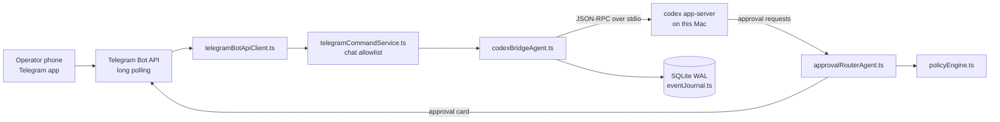

# Remote Codex Control (RCC)

RCC is a Telegram bot and a local daemon. It lets one operator watch, steer, and approve the actions of Codex coding agents that run on their own Mac.

## Why it matters

Coding agents stop and ask before they run commands or change files. If the person who started the task is away from the desk, the task waits. RCC sends each request to the operator's private Telegram chat with the project, thread, and action, so the operator can approve or deny it from a phone. The code and the files stay on the Mac.

## At a glance

- About 17,400 lines of TypeScript in 51 files. 13,663 lines are in `src/`. 3,548 lines are in one integration test file.
- 81 test cases. All 81 pass on macOS with Node 22.
- 12 SQLite tables, created by the migrations in `src/db/migrations.ts`. The database runs in WAL mode.
- 21 commands registered with the Telegram bot menu at startup.
- 5 policy checks: project allowlist, branch push, model switch, attachment path, and artifact send.
- 0 npm packages in a `dependencies` block. The application code imports only Node.js built-in modules. The start and test scripts use `tsx` and TypeScript, which are dev dependencies.
- MIT license.

## Demo without credentials

Watch it in a browser: [iampatelom.com/demos/remote-codex-control](https://iampatelom.com/demos/remote-codex-control) replays the session below step by step.

This replays an operator session against the daemon with mock Codex and Telegram clients. It needs no bot token, no Codex install, and no network.

```bash
npm ci && npm run demo
```

```text
operator> /status
rcc> RCC Status
     Daemon: alive
     Codex Transport: connected
     ...

operator> /projects
rcc> Projects (1)
     1. demo-app | ~/demo-app

operator> /new 1 Demo thread
rcc> Running
     ...
     Codex ID: <id-2>

operator> /approval_demo
rcc> Demo approval triggered for Demo thread
     Approval ID: <id-3>
     ...
     Actions: /approve <id-3> | /deny <id-3> | /approval <id-3>

operator> /approvals
rcc> Approvals
     Pending actionable: 1
     1. <id-3>
     ...

operator> /approve <id-3>
rcc> Approval resolved
     ...
     Approved request <id-3>

operator> /approve <id-3>
rcc> Callback already processed: approve:<id-3>

operator> /deny <id-3>
rcc> Request <id-3> already approved

operator> /approve does-not-exist
rcc> Command failed: Unknown approval does-not-exist

- Approval routing: a demo approval card reaches the operator chat, and /approve or /deny resolves it by ID.
- Idempotent callbacks: a repeated /approve is answered as already processed and does not act twice.
- Stale or unknown approvals are rejected: a resolved request cannot change, and an unknown ID gets an error.
```

Random IDs, times, and ages show as placeholders such as `<id-1>`, `<time>`, and `<age>`. The temp folder shows as `<tmp>`. `...` marks trimmed lines.

## How it works



- `src/adapters/telegram/telegramBotApiClient.ts` polls the Telegram Bot API with `getUpdates` and sends replies back.
- `src/services/telegramCommandService.ts` drops any update from a chat that is not on the allowlist. It then parses commands such as `/run`, `/say`, and `/approve`.
- `src/adapters/codex/codexAppServerClient.ts` starts `codex app-server --listen stdio://`. It writes newline-delimited JSON-RPC messages, such as `turn/start`, `turn/steer`, and `turn/interrupt`.
- `src/agents/codexBridgeAgent.ts` starts and resumes Codex threads. At startup it checks that the App Server supports the 8 methods it needs.
- `src/agents/approvalRouterAgent.ts` adds project and thread context to each approval. It rejects expired or superseded approvals. It answers a repeated button press without acting on it twice.
- `src/policies/policyEngine.ts` runs the policy checks. The artifact, attachment, git, and model-switch code paths call it.
- `src/db/database.ts` and `src/event-journal/eventJournal.ts` store operator-visible state in SQLite. The database runs in WAL mode.
- `src/utils/redaction.ts` masks secret-looking text before the bridge and the local status page show it.

## Tech stack

- Language and runtime: TypeScript 5.9 on Node.js. Tests run with `node:test` through `tsx`.
- Codex integration: Codex App Server over JSON-RPC on stdio, the default mode.
- Operator interface: Telegram Bot API, long polling, over `fetch`.
- State: SQLite through `node:sqlite`, in WAL mode.
- Local status page: a small HTTP server bound to `127.0.0.1`.
- Experimental: a static web console in `apps/web`, a relay function in `api/relay.js`, and a Supabase schema in `supabase/rcc_relay_schema.sql`.
- Optional always-on mode: a macOS LaunchAgent with `caffeinate`, from `scripts/install-launchd.sh`.

## Run it

Tested on macOS with Node 22:

```bash
git clone https://github.com/PATELOM925/Remote-Codex-Control-Public.git
cd Remote-Codex-Control-Public
npm ci
npm run typecheck
npm run build
npm test
npm run verify:quick
```

A local run with no Telegram bot and no Codex App Server. Codex and Telegram are both replaced by mock clients:

```bash
HOME="$(mktemp -d)" \
RCC_TELEGRAM_TRANSPORT=disabled \
RCC_CODEX_CONNECTION_MODE=mock \
RCC_OPERATOR_CHAT_ID=local-test \
RCC_LOCAL_STATUS_PORT=4799 \
RCC_RELAY_ENABLED=false \
node --import tsx src/main.ts

curl http://127.0.0.1:4799/api/health
```

Set `HOME` to an empty folder, as shown, so the thread list does not read your real `~/.codex` history. The daemon creates a `.dist/` folder inside the repo. That folder is git-ignored.

The real flow needs two more things:

- The real Telegram flow needs `setup.md` with a bot token from BotFather and your numeric chat ID. Then run `./run.sh`. `run.sh` exits with an error if `setup.md` is missing.
- A real Codex session needs the Codex app or CLI installed and signed in on the Mac.

## Tests

`npm test` runs the 81 test cases in `tests/rcc.integration.test.ts`. The run takes about 10 to 20 seconds. Examples of what they cover:

- Unknown chats are rejected (line 1189).
- A git push to `main` is blocked (line 1037).
- Stale approvals expire, and duplicate callbacks are idempotent (lines 1610 and 2552).
- Superseded approvals are rejected (line 3225).
- Attachment names with path traversal stay inside the thread folder (line 296).
- Artifact sends re-check that the file is inside the artifact root (line 2932).
- Secret-looking text is redacted (line 3133).
- The local status server refuses a non-local bind address (line 1015).

There is no CI workflow in this repo. The tests run only when you run them.

## Security model

The design assumes one trusted operator, one trusted Mac user session, one private Telegram bot, and an allowlist of chat IDs. It treats Telegram messages, uploaded files, generated artifacts, and model output as untrusted.

Main controls:

- Only allowlisted chat IDs can send commands.
- An uploaded file goes to a selected or named thread. It is stored under that thread's folder.
- Artifacts are listed first. A file is sent only when you ask for it by index or with `all`.
- Expired and superseded approvals cannot be approved or denied.
- Approval callbacks are idempotent.
- The local status page binds to `127.0.0.1` only.
- The bot token lives in `setup.md`, which is git-ignored.

Known limits:

- The Telegram bot token is a bearer credential. If it leaks, revoke it in BotFather.
- Secret redaction is best-effort. Do not paste secrets into Codex or RCC.
- Uploaded files can contain prompt injection.
- The Codex App Server protocol can change and break RCC.

The full threat model is in [SECURITY.md](./SECURITY.md) and [docs/THREAT_MODEL.md](./docs/THREAT_MODEL.md).

## My role

Solo project: design, implementation, security model and tests.

## Status and limits

- Public alpha. One Mac, one operator, one private Telegram bot.
- Telegram is the supported interface. The web console and the hosted relay are experimental and are not part of the setup path.
- Desktop UI approval automation is a prototype and is off by default.
- No multi-user access, no cloud execution, and no CI workflow.
- Node 22 prints an `ExperimentalWarning` for `node:sqlite`.
- The bot shows only reasoning summaries that the App Server exposes. It does not show hidden reasoning.

## Links

- [Install](./INSTALL.md): local Telegram setup.
- [Quickstart](./QUICKSTART.md): a first run in Telegram.
- [Examples](./EXAMPLES.md): common operator flows.
- [Architecture](./ARCHITECTURE.md): daemon, Telegram, Codex, state, and trust boundaries.
- [Architecture diagram](./docs/ARCHITECTURE_DIAGRAM.md): Mermaid diagrams and trust boundaries.
- [Telegram bot spec](./TELEGRAM_BOT_SPEC.md): the command contract.
- [Setup reference](./docs/SETUP_REFERENCE.md): every `setup.md` key.
- [Security](./SECURITY.md) and [threat model](./docs/THREAT_MODEL.md).
- [Always-on Mac runtime](./docs/MAC_ALWAYS_ON_RUNTIME.md): LaunchAgent and sleep limits.
- [Contributing](./CONTRIBUTING.md).
- [License](./LICENSE): MIT.
