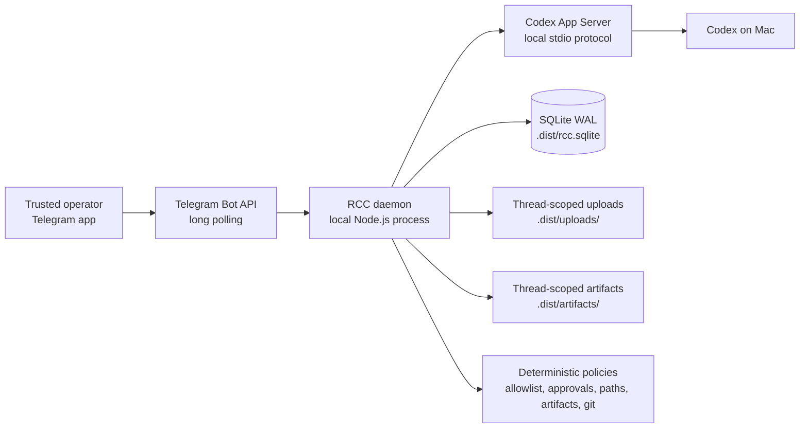
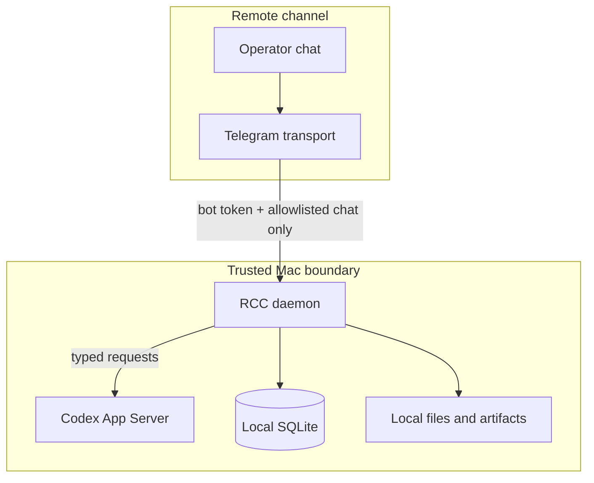
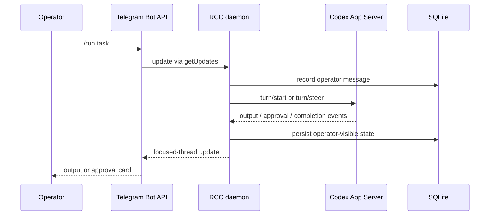

# RCC Architecture Diagram

Public alpha path: Telegram controls a local daemon; Codex, files, credentials, and state stay on the Mac.

## Trust Boundaries

Boundary rules:

- Telegram is a remote control channel, not a trust boundary by itself.
- `RCC_ALLOWED_CHAT_IDS` gates all Telegram commands.
- Attachments are untrusted and must be materialized into thread-scoped paths.
- Artifacts are list-first and explicit-send.
- Desktop UI automation is prototype-only and disabled by default.
- Web/relay code is not part of the public Telegram alpha path.

## Event Flow

